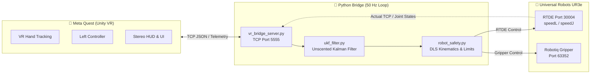

# UR3e VR Bridge 🦾🥽

> **Python Middleware for Real-Time Teleoperation of Universal Robots UR3e via Meta Quest VR**  
> ระบบมิดเดิลแวร์เชื่อมต่อแว่น Meta Quest VR เข้ากับหุ่นยนต์แขนกล UR3e แบบ Real-Time ด้วยโปรโตคอล RTDE สำหรับงานทดลองทางเคมีและควบคุมทางไกล (Remote Chemistry Teleoperation)

---

## 📐 โครงสร้างระบบ (System Architecture)



---

## 📂 โครงสร้างไดเรกทอรี (Directory Structure)

```text
ur3e-vr-bridge/
├── main.py                   # 🚀 จุดเริ่มต้นหลัก (CLI Entrypoint สำหรับ Teleop หรือ Sim)
├── test_move.py              # 🦾 สคริปต์ควบคุมหุ่นยนต์ UR3e จริงผ่าน RTDE + VR Bridge
├── test_vr_simulation.py     # 🧪 สคริปต์ทดสอบจำลอง (Simulation Test 10 ขั้นตอน Offline)
├── vr_bridge_server.py       # 📡 TCP Server รับส่งพิกัดและคำสั่งระหว่าง Unity กับ Python
├── robot_safety.py           # 🛡️ จลนศาสตร์ DLS, ขอบเขตความปลอดภัย (Sphere/Cylinder) และ Soft Limits
├── ukf_filter.py             # 🎯 Unscented Kalman Filter กรองสัญญาณมือสั่นและลด Jitter
├── requirements.txt          # 📦 รายการไลบรารี Python ที่ต้องติดตั้ง (ur_rtde, keyboard, numpy)
├── .gitignore                # 🙈 กำหนดไฟล์แคชและไฟล์ชั่วคราวที่ไม่ต้องอัปขึ้น Git
├── docs/                     # 📚 เอกสารคู่มือและข้อมูลทางเทคนิค
│   ├── 710-943-00_...pdf     # คู่มือผู้ใช้ทางการ UR3e (User Manual Global EN)
│   └── ur3e_manual_limits.md # ตารางสรุปขีดจำกัดความเร็ว, ระยะเอื้อม และข้อต่อของ UR3e
└── tools/                    # 🛠️ เครื่องมือช่วยและสคริปต์บำรุงรักษาระบบ
    └── apply_all_fixes.py    # สคริปต์แพตช์ Unity C# สำหรับระบบ Stereo SPI และ Hitbox
```

---

## ⚡ การติดตั้งและเตรียมความพร้อม (Installation)

### ข้อกำหนดของระบบ
- **Python**: แนะนำ **Python 3.12** *(เนื่องจากแพ็กเกจ `ur_rtde` มี Pre-built Wheel รองรับสมบูรณ์)*
- **หุ่นยนต์**: Universal Robots UR3e (Polyscope 5.x+, เปิดใช้งาน RTDE พอร์ต 30004)
- **แว่น VR**: Meta Quest 2 / 3 / Pro เชื่อมต่อผ่าน Wi-Fi หรือ Quest Link

### คำสั่งติดตั้ง Dependencies
```bash
# ติดตั้งแพ็กเกจทั้งหมดผ่าน requirements.txt
python -m pip install -r requirements.txt
```

*(หรือติดตั้งแยกด้วยตนเอง: `python -m pip install ur_rtde keyboard numpy`)*

---

## 🎮 วิธีการใช้งาน (How to Run)

### 1. โหมดทดสอบจำลอง (Offline VR Simulation)
ทดสอบระบบรับส่งข้อมูล, คำสั่งท่าทาง, และระบบความปลอดภัยทั้งหมดโดยไม่ต้องต่อหุ่นยนต์จริง:
```bash
python main.py --sim
# หรือรันตรงผ่าน:
python test_vr_simulation.py
```

### 2. โหมดควบคุมหุ่นยนต์จริง (Live UR3e Teleoperation)
ตรวจสอบว่าสาย LAN เชื่อมต่อกับคอนโทรลเลอร์ UR3e (IP เริ่มต้น: `192.168.1.20`):
```bash
python main.py
# หรือระบุ IP หุ่นยนต์:
python main.py --ip 192.168.1.20
# หรือรันตรงผ่าน:
python test_move.py
```

---

## 🕹️ แผนผังการควบคุม (Control & Gestures)

### 🥽 Meta Quest VR
| การกระทำ (Action) | ฟังก์ชันการทำงาน (Function) |
| :--- | :--- |
| **Right Hand Tracking** | ขยับมือขวา 6-DOF เพื่อบังคับปลายมือหุ่นยนต์ (TCP) ตามมือผู้ใช้ |
| **Right Hand Pinch** | จีบนิ้วชี้-หัวแม่มือขวา เพื่อสั่งปิด-เปิด Robotiq Gripper ตามระยะนิ้ว |
| **Left Pinch ค้าง 3 วิ** | หมุนแถบวงกลมครบรอบ 360° สั่งหุ่นยนต์กลับจุด **Safe Home** ทันที |
| **Left Controller [X]** | บันทึกจุด Origin ใหม่ และสั่งหุ่นยนต์กลับจุด Safe Home |
| **Left Controller [Y]** | สลับสถานะ **Pause / Resume** หยุดส่งพิกัดชั่วคราวอย่างปลอดภัย |
| **Left Controller Thumbstick** | กดก้านโยกเพื่อเริ่มโปรแกรม **Auto Shake** เขย่าหลอดทดลองอัตโนมัติ |

### ⌨️ คีย์บอร์ดคอมพิวเตอร์ (Jogging & Safety Overrides)
| ปุ่มคีย์บอร์ด | การทำงาน |
| :--- | :--- |
| **W / S** | เลื่อนแกน X (หน้า / หลัง) |
| **A / D** | เลื่อนแกน Y (ซ้าย / ขวา) |
| **R / F** | เลื่อนแกน Z (ขึ้น / ลง) |
| **H** | สั่งหุ่นยนต์เคลื่อนกลับ Safe Home |
| **Spacebar** | สั่งหยุดฉุกเฉิน (Emergency Stop / SpeedStop) ทันที |
| **1 / 2 / 3** | ปรับระดับเพดานความเร็ว (Slow / Normal / High) |
| **Esc** | สิ้นสุดโปรแกรมและตัดการเชื่อมต่ออย่างปลอดภัย |

---

## 🛡️ ระบบความปลอดภัย (Safety Architecture)

1. **Damped Least Squares (DLS) Jacobian**: คำนวณความเร็วข้อต่อแบบชดเชย Singularity ป้องกันแขนกลสะบัดหรือพุ่งเมื่อเข้าใกล้จุดวิกฤต
2. **3D Safety Envelope**: บังคับให้ปลาย TCP เคลื่อนที่เฉพาะในทรงกลมปลอดภัย (รัศมี 0.22 - 0.50 m) และทรงกระบอกความปลอดภัยรอบเสา Base
3. **Soft Rotation Limits**: ระบบตรวจสอบขอบเขตข้อต่อ เมื่อหมุนเหลืออีก 20-30° ระบบจะสั่งสั่นเตือนที่ข้อมือ bHaptics และหน่วงความเร็วลงอัตโนมัติ
4. **Unscented Kalman Filter (UKF)**: กรองสัญญาณรบกวนจากการสะบัดมือและอาการสั่น ให้การเคลื่อนไหวของหุ่นยนต์ราบรื่น นิ่ง และถนอมเกียร์ของแขนกล
