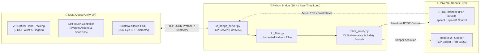

# UR3e VR Bridge 🦾🥽

> **High-Performance Python Middleware for Real-Time Teleoperation of Universal Robots UR3e via Meta Quest VR**  
> Enables low-latency, immersive bilateral teleoperation for hazardous chemistry experiments and robotic manipulation using optical hand tracking and controller inputs over RTDE.

---

## 📐 System Architecture



---

## 📂 Project Structure

```text
ur3e-vr-bridge/
├── main.py                   # 🚀 Unified CLI entrypoint (Teleoperation & Simulation)
├── test_move.py              # 🦾 Real-time UR3e teleoperation engine with RTDE & Gripper control
├── test_vr_simulation.py     # 🧪 Automated 10-step offline simulation test suite
├── vr_bridge_server.py       # 📡 High-throughput TCP server handling Unity <-> Python telemetry
├── robot_safety.py           # 🛡️ DLS Jacobian solver, 3D workspace envelopes & joint soft limits
├── ukf_filter.py             # 🎯 Unscented Kalman Filter (UKF) for jitter-free hand smoothing
├── requirements.txt          # 📦 Python package dependencies (ur_rtde, keyboard, numpy)
├── .gitignore                # 🙈 Git ignore rules (caches, virtual environments, binaries)
├── README.md                 # 📚 Project documentation
├── docs/                     # 📖 Hardware specifications and reference manuals
│   ├── 710-943-00_...pdf     # Official Universal Robots UR3e Global User Manual
│   └── ur3e_manual_limits.md # Hardware limits, payload capacity, reach & speed limits
└── tools/                    # 🛠️ Unity editor patches and maintenance utilities
    └── apply_all_fixes.py    # Unity C# patcher for Single Pass Instanced UI stereo fixes
```

---

## ⚡ Prerequisites & Installation

### Requirements
- **Operating System**: Windows 10/11 or Ubuntu Linux 20.04/22.04
- **Python**: **Python 3.12** is highly recommended *(guarantees pre-built binary wheel compatibility for `ur_rtde`)*
- **Robot**: Universal Robots UR3e (e-Series PolyScope 5.x+, RTDE enabled on Port 30004)
- **VR Headset**: Meta Quest 2 / 3 / Pro running the UR3e VR Unity client via Wi-Fi (LAN) or Meta Quest Link

### Setup Environment
```bash
# Clone the repository
git clone https://github.com/PhaiXD/ur3e-vr-bridge.git
cd ur3e-vr-bridge

# Install required dependencies
python -m pip install -r requirements.txt
```

> **Note for Windows Users**:  
> If running `pip` directly is restricted by system security policies, invoke it through Python:  
> `python -m pip install -r requirements.txt` or `py -3.12 -m pip install -r requirements.txt`

---

## 🎮 How to Run

### 1. Offline Simulation Mode (No physical robot required)
Verify network handshake, gesture detection, kinematics, and safety limits without hardware:
```bash
python main.py --sim
# or run directly:
python test_vr_simulation.py
```
*Executes all 10 automated unit & integration tests, verifying zero startup drift, deadband zone compliance, and limit deceleration.*

### 2. Live UR3e Teleoperation Mode
Connect your PC to the UR3e controller network (Default robot IP: `192.168.1.20`):
```bash
# Run with default IP (192.168.1.20)
python main.py

# Or specify a custom robot IP:
python main.py --ip 192.168.1.50

# Or run directly:
python test_move.py
```

---

## 🕹️ Control Scheme & Interaction

### 🥽 Meta Quest VR Gestures & Controller Mappings
| Input / Gesture | Functionality |
| :--- | :--- |
| **Right Hand Motion** | **6-DOF Cartesian Tracking**: End-effector smoothly mirrors user's hand pose in 3D space. |
| **Right Hand Pinch** | **Proportional Gripper Control**: Continuous pinch distance controls the Robotiq gripper opening/closing. |
| **Left Hand Pinch (Hold 3s)** | **Return to Safe Home**: Visual progress ring completes a full 360° circle to safely command the arm back to the Home pose. |
| **Left Controller [X]** | **Recenter & Home**: Re-calibrates coordinate origin and returns robot to Safe Home. |
| **Left Controller [Y]** | **Pause / Resume**: Instantly pauses teleoperation streaming without terminating connection. |
| **Left Thumbstick Click** | **Automated Tube Shake**: Triggers automated back-and-forth oscillation sequence for chemical mixing. |

### ⌨️ Host Keyboard Overrides & Safety Controls
| Key | Function |
| :--- | :--- |
| **W / S** | Jog TCP forward / backward along the X axis |
| **A / D** | Jog TCP left / right along the Y axis |
| **R / F** | Jog TCP up / down along the Z axis |
| **H** | Move arm to predefined Safe Home position |
| **Spacebar** | **Emergency Stop (E-Stop)**: Decelerates and halts all joint motions instantly (`speedStop`) |
| **1 / 2 / 3** | Toggle Cartesian speed ceiling: Slow (30%) / Normal (100%) / Max (300%) |
| **Esc** | Gracefully disconnects sockets, stops UR scripts, and exits |

---

## 🛡️ Safety & Kinematic Architecture

1. **Damped Least Squares (DLS) Jacobian**:
   - Calculates joint velocities from 6-DOF Cartesian velocities using adaptive damping factor $\lambda$.
   - Automatically stabilizes motions near kinematic singularities to prevent high-velocity arm flailing.

2. **3D Work Envelope Enclosure**:
   - **Outer Sphere ($R_{\max} = 0.50\text{ m}$)**: Clamps commands within physical kinematic reach.
   - **Inner Deadzone ($R_{\min} = 0.22\text{ m}$)**: Prevents collisions with the robot's own base column.
   - **Z-Plane Ceilings ($Z_{\min} = 0.05\text{ m}, Z_{\max} = 0.70\text{ m}$)**: Protects experiment bench and overhead fixtures.

3. **Soft Joint Rotation Limits & Deceleration**:
   - Actively monitors all 6 revolute joints in real-time.
   - When approaching within $20^\circ - 30^\circ$ of a hardware joint limit, rotation speed is scaled down smoothly while full reverse velocity is retained.
   - Dispatches bilateral haptic alerts to bHaptics wristbands and visual HUD warnings.

4. **Unscented Kalman Filter (UKF)**:
   - Filters high-frequency hand tremors and tracking occlusions from Meta Quest cameras.
   - Eliminates jerk and mechanical stress on the UR3e harmonic drives.

---

## 📡 Network & Port Configuration

| Port | Protocol | Component | Description |
| :---: | :---: | :--- | :--- |
| **5555** | TCP | `vr_bridge_server.py` | Primary VR telemetry stream between Unity Quest client and Python bridge |
| **30004** | TCP | Universal Robots RTDE | Real-Time Data Exchange interface (500 Hz control loop) |
| **63352** | TCP | Robotiq Gripper Server | Direct command interface for 2F-85 / 2F-140 / Hand-E grippers |
| **5557** | TCP | Simulation Test Suite | Dedicated local loopback port for unit testing |
