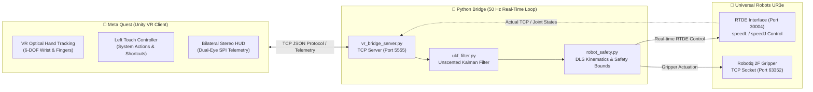

# UR3e VR Bridge 🦾🥽

> **High-Performance Python ↔ Unity Middleware for Real-Time Teleoperation of Universal Robots UR3e via Meta Quest VR**
>
> ระบบเชื่อมต่อ Teleoperation ความหน่วงต่ำระหว่าง Meta Quest VR กับหุ่นยนต์ UR3e แบบ Real-Time ผ่านโปรโตคอล RTDE — ออกแบบมาสำหรับงานทดลองเคมีอันตราย (Hazardous Chemistry) และการหยิบจับวัตถุ (Robotic Manipulation) ผ่าน Optical Hand Tracking & Controller Inputs

---

## 📐 System Architecture



### Data Flow Summary

```
[Meta Quest VR]                    [Python Bridge]                [UR3e Robot]
      │                                  │                             │
      │── POSE x y z rx ry rz ──────────>│                             │
      │── GRIP pos [force] ─────────────>│── Proportional POS ────────>│ Robotiq
      │── HOME / SHAKE / TARE ──────────>│── moveJ (Home/Shake) ──────>│ RTDE
      │                                  │                             │
      │                                  │── PD Controller ───────────>│
      │                                  │   ├─ compute_pose_error()   │
      │                                  │   ├─ Jacobian + DLS IK      │
      │                                  │   ├─ filter_cartesian_vel() │
      │                                  │   └─ speedL / speedJ ──────>│ RTDE
      │                                  │                             │
      │<── STATUS pos force spd ─────────│<── getActualTCPPose() ──────│
      │<──   x y z rx ry rz ────────────│<── getActualTCPForce() ─────│
      │<──   safety_proximity ───────────│<── getActualQ() ────────────│
      │<── ALERT level msg ──────────────│                             │
```

---

## 📂 Project Structure

```text
ur3e-vr-bridge/
│
│  ── Python Backend (รันบน PC เชื่อมต่อ UR3e ผ่าน Ethernet) ──
├── main.py                   # 🚀 CLI Entry Point: เรียก test_move.py (Real) หรือ test_vr_simulation.py (Sim)
├── test_move.py              # 🦾 Teleoperation Engine: RTDE Control Loop 50 Hz, Keyboard Jog, VR Tracking
├── vr_bridge_server.py       # 📡 TCP Server (Port 5555): รับ/ส่งข้อมูลระหว่าง Unity ↔ Python
├── robot_safety.py           # 🛡️ Safety Module: DLS Jacobian, 3D Workspace Envelope, Joint Soft Limits
├── ukf_filter.py             # 🎯 UKF (Unscented Kalman Filter): กรองสัญญาณแรงบีบ Gripper
├── test_vr_simulation.py     # 🧪 Offline Simulation: ทดสอบ 10 ขั้นตอนโดยไม่ต้องต่อหุ่นยนต์
├── requirements.txt          # 📦 Python Dependencies (ur_rtde, keyboard, numpy)
│
│  ── Unity C# Scripts (ใส่ใน Unity Project → Assets/Scripts/) ──
├── VRHandMover.cs            # 🖐️ Core: แปลงมือ VR → Target Pose 6-DOF → ส่ง POSE ไป Python
├── GripperBridge.cs          # 🔌 TCP Client: เชื่อมต่อ Python Bridge, ส่ง GRIP/POSE/HOME/SHAKE
├── VRPythonBridgeManager.cs  # ⚙️ Process Manager: สั่ง Start/Stop Python Bridge จากใน VR
├── PinchDetector.cs          # 🤏 Pinch Detection: วัดระยะนิ้วโป้ง-ชี้ → ค่า Gripper 0-255
├── OneEuroFilter.cs          # 📊 1€ Filter: กรองตำแหน่งและการหมุนมือ VR ให้นุ่มนวล
├── VRHandStereoFixer.cs      # 👀 Stereo Fix: แก้ไขมือ VR ให้แสดงทั้ง 2 ตาใน SPI
├── UR3eStarterPoint.cs       # 📍 Home Point: สร้าง/จัดการจุด Home ของ UR3e ใน VR Scene
├── SafetyBoundaryVisualizer.cs # 🟢 Safety Visualizer: แสดง Sphere/Cylinder/Z-Plane ใน 3D
├── LeftHandHomeTrigger.cs    # 🏠 Left Hand: จีบมือซ้ายค้าง 3 วินาที → สั่ง Home
├── HandDebugHUD.cs           # 📺 Debug HUD: แสดง Telemetry บนข้อมือใน VR
├── VRWristTelemetry.cs       # ⌚ Wrist Telemetry: แสดงข้อมูล Force, Speed, Safety บนข้อมือ
├── VRMenuManager.cs          # 📋 VR Menu: เมนูหลักแบบ 3D World Space UI
├── VRCameraWindow.cs         # 📹 Camera Window: แสดง Webcam Feed บน Quad ใน VR
├── VRRemoteLaserPointer.cs   # 🔴 Laser Pointer: ตัวชี้ Laser สำหรับกดปุ่ม UI ใน VR
├── VRKeybindManager.cs       # ⌨️ Keybind Manager: จัดการ Shortcut ปุ่มรีโมท Quest
├── VRWindowDragger.cs        # ✋ Window Drag: ลาก-ย้ายหน้าต่างใน VR
├── VRWindowResizer.cs        # ↔️ Window Resize: ปรับขนาดหน้าต่างใน VR
├── BhapticsGloveFeedback.cs  # 🧤 bHaptics: สั่นถุงมือ Haptic ตามแรงบีบ Gripper
│
│  ── Documentation & Config ──
├── README.md                 # 📚 เอกสารนี้
├── .gitignore                # 🙈 Git Ignore Rules
├── .gitattributes            # Git Attributes
└── docs/                     # 📖 Hardware Specifications
    ├── 710-943-00_...pdf     # Official UR3e Global User Manual
    └── ur3e_manual_limits.md # สรุป Hardware Limits, Reach, Speed
```

---

## ⚡ Prerequisites & Installation

### ข้อกำหนดระบบ

| Component | Requirement |
|:---|:---|
| **OS** | Windows 10/11 หรือ Ubuntu 20.04/22.04 |
| **Python** | **Python 3.12** (จำเป็น เพราะ `ur_rtde` มี pre-built wheel เฉพาะ 3.12) |
| **Robot** | Universal Robots UR3e (PolyScope 5.x+, RTDE Port 30004 เปิดอยู่) |
| **Gripper** | Robotiq 2F-85 / 2F-140 / Hand-E (TCP Port 63352 ของ UR Controller) |
| **VR Headset** | Meta Quest 2 / 3 / Pro (ต่อผ่าน Wi-Fi LAN หรือ Quest Link) |
| **Unity** | Unity 2022.3 LTS+ พร้อม URP, Meta XR SDK, Hand Tracking |
| **Network** | PC ต่อ UR3e ผ่าน Ethernet (ต้อง Subnet เดียวกัน เช่น 192.168.1.x) |

### Setup Environment

```bash
# 1. Clone Repository
git clone https://github.com/PhaiXD/ur3e-vr-bridge.git
cd ur3e-vr-bridge

# 2. ติดตั้ง Dependencies (ใช้ Python 3.12)
py -3.12 -m pip install -r requirements.txt

# หรือถ้า pip ตรงถูก restrict:
python -m pip install -r requirements.txt
```

### Dependencies ที่ติดตั้ง

| Package | Version | Purpose |
|:---|:---|:---|
| `ur_rtde` | ≥ 1.6.0 | Real-Time Data Exchange: `rtde_control` + `rtde_receive` |
| `keyboard` | ≥ 0.13.5 | Keyboard jogging + Emergency Stop |
| `numpy` | ≥ 1.24.0 | Numerical calculations |

---

## 🎮 How to Run

### 1. 🧪 Offline Simulation (ไม่ต้องต่อหุ่นยนต์จริง)

ทดสอบ TCP Handshake, Gesture Detection, Kinematics, Safety Limits:

```bash
python main.py --sim
# หรือรันตรง:
python test_vr_simulation.py
```

รันทดสอบ 10 ขั้นตอนอัตโนมัติ: ตรวจ Zero Startup Drift, Deadband Compliance, Limit Deceleration

### 2. 🤖 Live UR3e Teleoperation (ต่อหุ่นยนต์จริง)

```bash
# ใช้ IP เริ่มต้น (192.168.1.20)
python main.py

# ระบุ IP ของหุ่นยนต์:
python main.py --ip 192.168.1.50

# หรือรันตรง:
python test_move.py 192.168.1.50
```

### 3. 📡 TCP Server แบบ Standalone (ทดสอบ VR โดยไม่ต่อหุ่น)

```bash
python vr_bridge_server.py
```

เปิด TCP Server Port 5555 รับค่า Pinch/Move จาก Unity โดยไม่ต้องเชื่อมต่อ UR3e

---

## 🕹️ Control Scheme

### 🥽 Meta Quest VR — Hand Tracking & Controller

| Input / Gesture | Functionality |
|:---|:---|
| **Right Hand Motion** | **6-DOF Cartesian Tracking**: ปลายแขนกลเคลื่อนตามมือผู้ใช้ใน 3D (Position + Orientation) |
| **Right Hand Pinch** | **Proportional Gripper**: ระยะนิ้วโป้ง-ชี้ → ค่า Gripper 0-255 ต่อเนื่อง |
| **Left Hand Pinch (Hold 3s)** | **Return Home**: วงแหวน Progress 360° → สั่งกลับ Safe Home |
| **Left Controller [X]** | **Recenter & Home**: รีเซ็ตจุดอ้างอิง + กลับท่า Safe Home |
| **Left Controller [Y]** | **Pause / Resume**: หยุด/เล่นต่อ Teleoperation ทันที |
| **Left Thumbstick Click** | **Auto Shake**: เขย่าสาร (หมุน Wrist 3 ±180° × 3 รอบ) |
| **Right Controller Grip (Hold)** | **Gripper Lock**: ล็อก Gripper ค้างไว้ที่ตำแหน่งปัจจุบัน |

### ⌨️ Keyboard Controls (Host PC)

| Key | Function |
|:---|:---|
| **W / S** | Jog TCP +X / -X (เดินหน้า / ถอยหลัง) |
| **A / D** | Jog TCP +Y / -Y (ซ้าย / ขวา) |
| **Space / Ctrl** | Jog TCP +Z / -Z (ขึ้น / ลง) |
| **Numpad 8/2** | Wrist 1 +/- |
| **Numpad 6/4** | Wrist 2 +/- |
| **Numpad 9/7** | Wrist 3 +/- |
| **= / -** | Gripper Close / Open (กดค้าง) |
| **H** | กลับ Safe Home (moveJ) |
| **K** | เขย่าสารอัตโนมัติ 3 รอบ |
| **T** | Tare: เซ็ตศูนย์แรง Fz |
| **[ / ]** | ลด / เพิ่มความเร็ว (10% → 25% → 50% → 75% → 100%) |
| **1-6** | Toggle Invert แกน VR (1:X, 2:Y, 3:Z, 4:Roll, 5:Pitch, 6:Yaw) |
| **Q** | ออกจากโปรแกรม |

---

## 📡 TCP Protocol Specification

ระบบสื่อสารระหว่าง Unity (C#) ↔ Python ผ่าน TCP Socket Port **5555** ด้วย ASCII Text Protocol แบบ Newline-terminated:

### Unity → Python (Commands)

| Command | Format | Description |
|:---|:---|:---|
| **POSE** | `POSE <x> <y> <z> <rx> <ry> <rz>\n` | Target Pose 6-DOF (เมตร, radian) จาก VR Hand |
| **GRIP** | `GRIP <pos> [force]\n` | Gripper Position (0=เปิดสุด, 255=ปิดสุด) |
| **MOVE** | `MOVE <vx> <vy> <vz> [wx] [wy] [wz]\n` | Velocity 6-DOF (m/s, rad/s) — Fallback mode |
| **HOME** | `HOME\n` | สั่งกลับ Safe Home Position |
| **TARE** | `TARE\n` | เซ็ตศูนย์แรง Fz |
| **SHAKE** | `SHAKE\n` | เขย่าสารอัตโนมัติ 3 รอบ |
| **PAUSE** | `PAUSE <0\|1>\n` | Pause (1) / Resume (0) Teleoperation |
| **SPEED** | `SPEED <0-100>\n` | ตั้งระดับความเร็ว (%) |

### Python → Unity (Feedback)

| Message | Format | Description |
|:---|:---|:---|
| **STATUS** | `STATUS <pos> <force> <spd%> <x> <y> <z> <rx> <ry> <rz> [outer_r inner_r cyl_r spd_r rot_r j_idx deg_left]\n` | พิกัดจริง + แรงบีบ + Safety Proximity |
| **ALERT** | `ALERT <WARNING\|ERROR\|INFO\|SUCCESS> <message>\n` | แจ้งเตือน/ข้อผิดพลาด |
| **SHAKE** | `SHAKE START\n` / `SHAKE DONE\n` | สถานะเขย่าสาร |

### Safety Proximity Fields

| Field | Description | Range |
|:---|:---|:---|
| `outer_r` | ระยะใกล้ขอบนอก (Outer Sphere R=550mm) | 0.0 – 1.0 |
| `inner_r` | ระยะใกล้ขอบใน (Inner Sphere R=230mm) | 0.0 – 1.0 |
| `cyl_r` | ระยะใกล้ Cylinder Exclusion (R=95mm) | 0.0 – 1.0 |
| `spd_r` | ระดับความเร็ว TCP ใกล้เพดาน (300mm/s) | 0.0 – 1.0 |
| `rot_r` | ระดับความใกล้ขีดจำกัดมุมข้อต่อ | 0.0 – 1.0 |
| `j_idx` | Index ข้อต่อที่ใกล้ขอบที่สุด (0-5) | 0 – 5 |
| `deg_left` | องศาคงเหลือก่อนถึงขีดจำกัด (°) | 0.0 – 999.0 |

---

## 🛡️ Safety Architecture

### 1. 3D Workspace Envelope

```
                    ┌─── MAX_Z = 720mm ──────────────────────┐
                    │                                        │
            ┌───────┴────────────────────────────────────────┤
            │          Outer Sphere (R_max = 550mm)          │
            │      ┌────────────────────────────────┐        │
            │      │   Inner Sphere (R_min = 230mm) │        │
            │      │      ┌───────────┐             │        │
            │      │      │ Cylinder  │ R = 95mm    │        │
            │      │      │ Exclusion │ (Singularity│        │
            │      │      │   Zone    │  Protection)│        │
            │      │      └───────────┘             │        │
            │      └────────────────────────────────┘        │
            └────────────────────────────────────────────────┤
                    └─── MIN_Z = -50mm ──────────────────────┘
```

| Parameter | Value | Purpose |
|:---|:---|:---|
| **Outer Sphere** | R = 550mm จาก Shoulder | ป้องกันเอื้อมเกินระยะถึง |
| **Inner Sphere** | R = 230mm จาก Shoulder | ป้องกันชนฐาน/ตัวเอง |
| **Cylinder Exclusion** | R = 95mm รอบแกน Z | ป้องกัน Singularity บริเวณแกนฐาน |
| **Z-Plane Ceiling** | 720mm (บน), -50mm (ล่าง) | ป้องกันชนโต๊ะและเพดาน |
| **TCP Speed Cap** | 300 mm/s | ตัดแรงเฉื่อยเด็ดขาด |

### 2. Damped Least Squares (DLS) Jacobian

```
qd = (J^T · J + λ² · I)^(-1) · J^T · v
```

- คำนวณ Geometric Jacobian 6×6 จาก DH Parameters ของ UR3e
- Damping factor λ ป้องกันความเร็วพุ่งทะลุเมื่อเข้าใกล้ Singularity
- Gaussian Elimination + Partial Pivoting สำหรับ Solve ระบบสมการ

### 3. Joint Soft Limits & Directional Deceleration

| Joint | Range | Home Angle |
|:---|:---|:---|
| J1 Base | -170° to +170° | 0° |
| J2 Shoulder | -165° to -15° | -90° |
| J3 Elbow | -150° to -15° | -90° |
| J4 Wrist 1 | -275° to +90° | -180° |
| J5 Wrist 2 | -170° to +170° | -90° |
| J6 Wrist 3 | -360° to +360° | 180° |

**Directional Protection**: เมื่อใกล้ขอบ (ภายใน 30°) → ชะลอเฉพาะทิศที่ฝืนขอบ แต่ถอยกลับได้เต็มที่ 100%

### 4. Speed Limiters

| Joint Group | Max Speed |
|:---|:---|
| J1-J3 (Arm) | 100°/s |
| J4-J6 (Wrist) | 240°/s |

ก่อนส่ง `speedL` ทุกรอบ จะคำนวณ Jacobian → ตรวจว่า Joint Speed ไม่เกินเพดาน → Scale ลงอัตโนมัติ

### 5. Unscented Kalman Filter (UKF)

กรองค่าแรงบีบ Gripper (Fz) ให้เรียบเนียน:

- **State**: `[force (N), d_force/dt (N/s)]`
- **Sigma Points**: 2n+1 = 5 จุด (Pure Python, ไม่พึ่ง numpy)
- Auto-Tare เมื่ออ้านิ้ว ≤ 35/255

---

## 📡 Network & Port Configuration

| Port | Protocol | Component | Description |
|:---:|:---:|:---|:---|
| **5555** | TCP | `vr_bridge_server.py` | VR ↔ Python telemetry stream |
| **30004** | TCP | UR3e RTDE | Real-Time Data Exchange (500 Hz) |
| **63352** | TCP | Robotiq Gripper | Direct command interface |
| **29999** | TCP | UR Dashboard Server | Protective Stop recovery |
| **5557** | TCP | Simulation Suite | Local loopback for unit testing |

---

## 🔧 Unity Setup Guide

### ติดตั้ง C# Scripts ลงใน Unity Project

1. **คัดลอกไฟล์ `.cs` ทั้งหมด** ไปยัง `Assets/Scripts/` ในโปรเจค Unity
2. **ตั้งค่า Scene**:
   - สร้าง Empty GameObject ชื่อ `UR3eVRSystem`
   - ใส่ Component ทีละตัวตามลำดับ:

| Component | Attach To | Role |
|:---|:---|:---|
| `VRHandMover` | UR3eVRSystem | Core hand tracking controller |
| `GripperBridge` | UR3eVRSystem | TCP client สื่อสาร Python |
| `PinchDetector` | UR3eVRSystem | วัดระยะนิ้วโป้ง-ชี้ |
| `LeftHandHomeTrigger` | UR3eVRSystem | จีบมือซ้ายค้าง 3s = Home |
| `VRHandStereoFixer` | UR3eVRSystem | แก้ Stereo rendering |
| `UR3eStarterPoint` | UR3eVRSystem | จัดการจุด Home |
| `SafetyBoundaryVisualizer` | UR3eVRSystem | แสดงขอบเขตปลอดภัย |
| `VRMenuManager` | Empty "VRMenu" | UI Menu system |
| `VRPythonBridgeManager` | Empty "BridgeMgr" | สั่ง Start/Stop Python |
| `OneEuroFilter` | (ถูกเรียกโดย VRHandMover) | Signal filter |

3. **ตั้งค่า GripperBridge Inspector**:
   - `Server IP`: `127.0.0.1` (ถ้า Python รันบนเครื่องเดียวกัน) หรือ IP ของ PC ที่รัน Python
   - `Server Port`: `5555`
   - `Send Rate Hz`: `50`

4. **ตั้งค่า VRPythonBridgeManager Inspector** (ถ้าต้องการสั่ง Python จาก VR):
   - `Python Exe Path`: Path ไปที่ `python.exe` (3.12)
   - `Script Directory`: Path ไปที่โฟลเดอร์ `ur3e-vr-bridge`
   - `Target Robot IP`: `192.168.1.20`

### Dependencies ของ Unity

- **Meta XR SDK** (ติดตั้งผ่าน Unity Package Manager)
- **Universal Render Pipeline (URP)**
- **Unity Input System** (New Input System)
- **bHaptics SDK** (Optional — สำหรับ BhapticsGloveFeedback)

---

## 🧬 Developer Guide — การพัฒนาต่อ

### Architecture Overview

โปรเจคแบ่งเป็น 2 ฝั่งที่สื่อสารกันผ่าน TCP:

```
┌──────────────────────┐         TCP 5555        ┌──────────────────────┐
│   Unity C# (Quest)   │◄──────────────────────►│   Python (PC)        │
│                       │                        │                       │
│  VRHandMover          │── POSE ───────────────►│  vr_bridge_server    │
│  PinchDetector        │── GRIP ───────────────►│  test_move.py        │
│  GripperBridge        │◄── STATUS ────────────│  robot_safety.py     │
│  VRMenuManager        │◄── ALERT ─────────────│  ukf_filter.py       │
│  VRPythonBridgeManager│── (Process Control) ──►│  main.py             │
└──────────────────────┘                        └──────────────────────┘
```

### เพิ่มคำสั่งใหม่ (New TCP Command)

**ตัวอย่าง**: เพิ่มคำสั่ง `ROTATE <angle>` สำหรับหมุน Wrist 3

**ฝั่ง Python** — แก้ `vr_bridge_server.py`:

```python
# ใน _server_loop(), เพิ่มใน while loop ที่ parse commands:
elif line.startswith("ROTATE"):
    parts = line.split()
    if len(parts) >= 2:
        angle = float(parts[1])
        if self.on_rotate_callback:
            self.on_rotate_callback(angle)
```

จากนั้นเพิ่ม callback ใน `__init__()`:
```python
def __init__(self, ..., on_rotate_callback=None):
    self.on_rotate_callback = on_rotate_callback
```

และ register callback ใน `test_move.py`:
```python
def on_vr_rotate(angle):
    # หมุน Wrist 3 ไปที่มุมที่กำหนด
    q = list(rtde_r.getActualQ())
    q[5] = math.radians(angle)
    rtde_c.moveJ(q, J_SPEED, J_ACCEL)

vr_server = VRBridgeServer(..., on_rotate_callback=on_vr_rotate)
```

**ฝั่ง Unity** — แก้ `GripperBridge.cs`:

```csharp
public void SendRotate(float angleDeg)
{
    SendCommand($"ROTATE {angleDeg:F1}");
}
```

### เพิ่ม Safety Boundary ใหม่

แก้ `robot_safety.py` → ฟังก์ชัน `filter_cartesian_velocity()`:

```python
# เพิ่ม Boundary Check ก่อน return
# ตัวอย่าง: เพิ่ม Bounding Box สำหรับโต๊ะทดลอง
TABLE_X_MIN, TABLE_X_MAX = -0.30, 0.30  # m
TABLE_Y_MIN, TABLE_Y_MAX = -0.30, 0.30  # m

if x < TABLE_X_MIN and vx < 0:
    vx = 0.0  # ล็อกทิศที่ฝืนขอบ
if x > TABLE_X_MAX and vx > 0:
    vx = 0.0
```

### ปรับจูน PD Controller (VR Hand Tracking)

พารามิเตอร์สำคัญใน `test_move.py`:

| Parameter | Default | Description |
|:---|:---|:---|
| `kp_pos` | 3.2 × √speed | Position P-gain (สูง = ตอบสนองเร็ว, ต่ำ = นุ่มนวล) |
| `kd_pos` | 0.20 | Position D-gain (Velocity Damping) |
| `kp_rot` | 3.6 × √speed | Rotation P-gain |
| `kd_rot` | 0.05 | Rotation D-gain |
| Settle threshold (pos) | 3.5mm enter / 6.0mm exit | Hysteresis Deadband |
| Settle threshold (rot) | 0.85° enter / 2.0° exit | Rotation Deadband |

```python
# ถ้าต้องการให้ตอบสนองเร็วขึ้น (อาจสั่นมากขึ้น):
kp_pos = min(5.0, 4.0 * math.sqrt(speed_level))

# ถ้าต้องการให้นุ่มนวลกว่า (อาจ lag นิดหน่อย):
kp_pos = min(3.0, 2.5 * math.sqrt(speed_level))
kd_pos = 0.35
```

### ปรับจูน Velocity Ramp (S-Curve)

| Parameter | Default | Description |
|:---|:---|:---|
| `a_lin` (brake) | 2.50 m/s² | อัตราเร่งเบรกเชิงเส้น |
| `a_lin` (accel, pose mode) | 1.50-2.50 m/s² | อัตราเร่งเชิงเส้น |
| `a_rot` (brake) | 35.0 rad/s² | อัตราเร่งเบรกเชิงมุม |
| `a_rot` (accel, pose mode) | 15.0 × speed | อัตราเร่งเชิงมุม |
| `VR_TRACKING_MAX_SPEED` | 200 mm/s | เพดานความเร็วติดตามมือ VR |
| `VR_TRACKING_MAX_ROT` | 3.80 rad/s (~218°/s) | เพดานความเร็วหมุนข้อมือ |

### เพิ่ม Component ใหม่ใน Unity

1. สร้างไฟล์ `.cs` ใหม่ใน namespace `UR3eVR`
2. ถ้าต้องอ้างอิง `GripperBridge`:
   ```csharp
   private GripperBridge gripperBridge;
   void Start()
   {
       gripperBridge = FindAnyObjectByType<GripperBridge>();
   }
   ```
3. ถ้าต้องส่งข้อมูลไป Python:
   ```csharp
   gripperBridge.SendCommand("YOUR_CMD param1 param2");
   ```
4. ถ้าต้องรับ Alert/Log จาก Python:
   ```csharp
   void OnEnable()
   {
       GripperBridge.OnAlertReceived += HandleAlert;
   }
   void HandleAlert(string level, string message) { ... }
   ```

---

## 🏠 Home Position & Coordinate System

### UR3e Home Pose (Joint Space)

```
Base = 0°, Shoulder = -90°, Elbow = -90°
Wrist 1 = -180°, Wrist 2 = -90°, Wrist 3 = 180°
```

### Coordinate Frame

```
       Z ↑ (ขึ้น)
       │
       │    X → (หน้า)
       │   /
       │  /
       └──────── Y ← (ซ้าย)
     [Base]
```

- **Base Frame**: จุดกำเนิดอยู่ที่ฐานหุ่นยนต์
- **TCP (Tool Center Point)**: ปลาย Gripper
- **Pendant Frame**: Z_pendant = Z_base - 400mm (UR Controller แสดง Z สัมพัทธ์กับ Pendant)

---

## 🐛 Troubleshooting

### ปัญหาที่พบบ่อย

| ปัญหา | สาเหตุ | วิธีแก้ |
|:---|:---|:---|
| `ModuleNotFoundError: rtde_control` | Python version ไม่ใช่ 3.12 | ติดตั้ง Python 3.12 และใช้ `py -3.12 -m pip install ur_rtde` |
| Protective Stop ขณะใช้งาน | ความเร็วข้อต่อเกิน Safety Limit | ลดค่า `speed_level` ด้วยปุ่ม `[` หรือลดค่า `VR_TRACKING_MAX_SPEED` |
| Unity ไม่เชื่อมต่อ Python | Firewall บล็อก Port 5555 | เปิด Port 5555 ใน Windows Firewall หรือใช้ `127.0.0.1` |
| มือ VR แสดงตาเดียว | Single Pass Instanced ไม่ทำงาน | ตรวจสอบว่า `VRHandStereoFixer` ติดอยู่ใน Scene |
| Gripper ไม่ตอบสนอง | Gripper ยังไม่ Activate | กด Reset Fault ที่ Teach Pendant หรือรอ Auto-Activate |
| แขนกลไม่ขยับตามมือ VR | ยังไม่ได้ Set Origin | กด [X] บนรีโมทซ้ายเพื่อ Recenter |
| แขนกลส่ายไม่หยุด | kp สูงเกินไป หรือ latency สูง | ลด `kp_pos` / เพิ่ม `kd_pos` / ตรวจสอบ Wi-Fi latency |

### Recovery จาก Protective Stop

ระบบจะ **กู้คืนอัตโนมัติ** ผ่าน Dashboard Server (Port 29999):

1. ส่ง `unlock protective stop` ไปที่ Port 29999
2. รอ Safety Status = NORMAL
3. Reupload RTDE Control Script
4. ถ้าไม่สำเร็จ → แจ้งให้กด Resume บน Teach Pendant

---

## 📄 License & Credits

- **UR3e Manual**: © Universal Robots A/S
- **Robotiq Gripper**: © Robotiq Inc.
- **Meta Quest SDK**: © Meta Platforms, Inc.
- **bHaptics SDK**: © bHaptics Inc.
